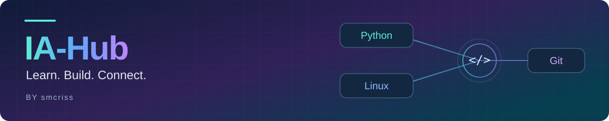

[English](README.md) · [Deutsch](README.de.md)

# IA-Hub

**Python-Übungen, kleine Projekte und ein Weg zu Automatisierung und KI.**

In IA-Hub setze ich mein Wissen praktisch um: Ich schreibe Code, erkunde Entwicklungswerkzeuge und entwickle kleine Programme. Mit der Zeit möchte ich diese Grundlagen zu einem persönlichen Hub für KI-Werkzeuge und Automatisierung im Alltag verbinden.

## Entdecken

| Bereich | Inhalt |
| --- | --- |
| [Python-Übungen](python-learning/) | Übungen zu Programmiergrundlagen, Datenstrukturen und Funktionen. |
| [Kleine Projekte](projects/) | Einfache Programme, mit denen ich das Gelernte anwende, darunter [ConcenTrack](projects/concentrack.py), ein Terminalprogramm zum Erfassen von Lernsitzungen. |

## Kenntnisse & Werkzeuge

- **Python:** Grundkenntnisse durch die Cisco Networking Academy und selbstständige Übungen. [Python Essentials 1](https://www.credly.com/badges/aa5b4306-264d-4bfe-bfcf-1bbcf4779fe6/public_url) am 18.10.2026 abgeschlossen; Python Essentials 2 in Bearbeitung.
- **Linux & Entwicklungswerkzeuge:** praktische Erfahrung mit Ubuntu, dem Terminal, VS Code, virtuellen Umgebungen und Paketverwaltung.
- **Git & GitHub:** Versionskontrolle, Commits, Organisation von Repositories und Dokumentation.

Ich lerne, indem ich Probleme in einzelne Schritte zerlege, eigene Lösungen ausprobiere und die Ergebnisse überprüfe. Dieses Repository dokumentiert diesen Prozess anhand von Code.

## Wohin es geht

**Grundlagen → nützliche Programme → Automatisierung & KI**

Als Nächstes möchte ich mit Dateien, Fehlerbehandlung und Datenspeicherung arbeiten und anschließend APIs und Automatisierung erkunden. Langfristig möchte ich verschiedene KI-Werkzeuge und Workflows in einem persönlichen Hub zusammenführen.

IA-Hub ist ein wachsendes Lernprojekt; die KI-Integration ist ein zukünftiges Ziel.

---

Erstellt von [smcriss](https://github.com/smcriss) · [Über mich](https://github.com/smcriss#readme)
